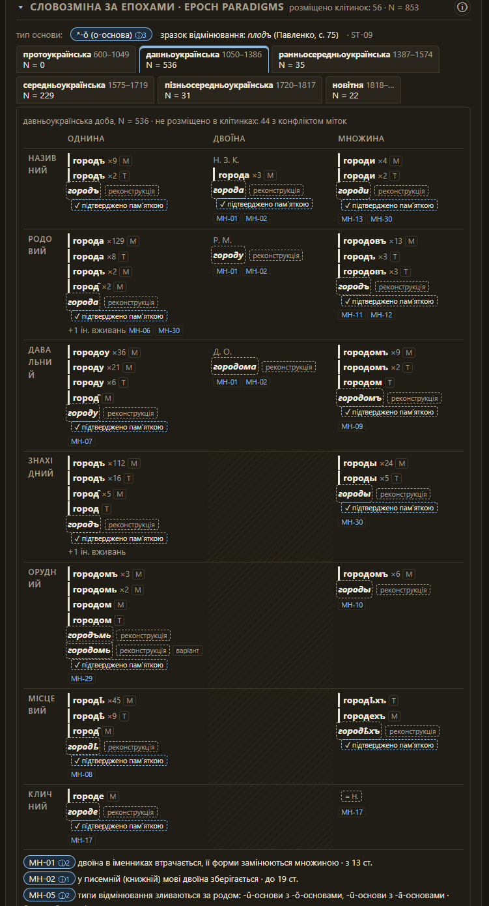

I have always been curious about where words come from. A familiar word can carry traces of old sound changes, contact between communities, regional pronunciation, or a spelling that disappeared from everyday use centuries ago. I wanted to see how far I could follow those traces, and whether software could make the evidence easier to explore.

That question became [BULP](https://github.com/dmytrozahor/BULP), a provenance lexicon of Ukrainian word forms. It connects forms to the witnesses where they occur, records how early they are attested, and lets a reader inspect the evidence behind a claim. The [live site](https://dmytrozahor.github.io/BULP/) already offers word pages, search, analysis, derivation, texts, corpus views, and a map.

<blockquote class="pull">
The interesting question is not only “How old is this word?” but “What evidence lets me say that?”
</blockquote>

## A language is more than its surviving books

The first idea sounds simple: collect old texts, find words, and sort them by date. But a historical corpus is not a transparent window onto the past. Texts survive unevenly. Some are copied long after they were composed; others are known through editions that normalize spelling or include editorial material. Most preserved writing represents a narrow slice of life, while speech, local vocabulary, and ordinary variation are much less likely to leave a record.

This matters especially for Ukrainian. In the fourteenth century, much of the territory of present-day Ukraine came under the Grand Duchy of Lithuania and the Kingdom of Poland, not the Russian Empire. A Ruthenian written language was used in the Grand Duchy’s administration and legal culture, alongside Church Slavonic and local spoken varieties. The relationship between those written forms and the later Ukrainian and Belarusian standards is historically complex, so BULP records the language and period of a witness instead of applying modern national labels backwards. The [Encyclopedia of Ukraine’s account of standard Ukrainian](https://www.encyclopediaofukraine.com/display.asp?linkpath=pages%5CS%5CT%5CStandardUkrainian.htm) describes the fourteenth to eighteenth centuries as a distinct middle period and notes the role of Ruthenian in the Lithuanian-Ruthenian state.

The spoken language did not wait for a modern literary standard to exist. Regional speech continued changing in villages and towns, while the surviving written record favored institutions, clergy, officials, and authors. Later Russian imperial expansion and Russification policies shaped which languages could be printed, taught, and used in public life; these developments unfolded over centuries, not as a single takeover in the fourteenth century. The [Encyclopedia of Ukraine’s overview of Russification](https://www.encyclopediaofukraine.com/display.asp?linkpath=pages%5CR%5CU%5CRussification.htm) describes those later policies, including restrictions on Ukrainian-language publishing.

Image source and rights: [Wikimedia Commons](https://commons.wikimedia.org/wiki/File:Graffiti_St._Sophia%27s_Cathedral_in_Kiev_(1097)._-_1.jpg), a public-domain reproduction of an inscription documented by S. A. Vysotsky.

That gap between speech and record is one of the reasons I want to mine more than canonical books. A broader language dataset could bring together dated manuscripts and editions, regional dictionaries, dialect surveys, place names, songs, letters, newspapers, oral-history transcripts, and contemporary contributions from speakers. Each source type answers different questions. A chronicle can give an early written attestation; a dialect recording can show a form still alive in a region; a place name may preserve an older layer that ordinary text no longer uses.

The goal would not be to pretend these sources are interchangeable. It would be to let people compare them while seeing where each item came from, when it was collected, what region it represents, and how reliable its transcription is.

## From assumptions to evidence, and from rules to usage

Working on BULP has made me think about two distinctions that are easy to blur when talking about language: **a priori and a posteriori knowledge**, and **prescriptivism and descriptivism**.

I use “a priori” here in a practical, local sense: what I bring to a particular corpus item before examining it, such as a sound correspondence described in linguistic literature or the hypothesis that an older form may connect to a modern lemma. Linguistic theory itself is built from observation, so I do not mean that these rules exist independently of evidence. They narrow the search, but do not prove that a specific word occurred in a particular place or year. A posteriori evidence for that claim comes from the sources: the spelling in a witness, its context, date range, locator, and the editorial choices behind the transcription. BULP uses prior linguistic knowledge to generate explainable candidates, then asks the attested data to support or reject the link. If the evidence is missing or ambiguous, the result should remain unresolved.

The same distinction matters when describing what counts as “good Ukrainian.” Prescriptive sources define or recommend a standard: dictionaries and style guides can tell us what is accepted in a given norm. Descriptive sources document what speakers and writers actually use, including regional forms, historical variants, colloquial language, and contact effects. These are different questions, not mutually exclusive camps: a prescriptive dictionary is also evidence about the norm it describes. BULP needs both kinds of information, but it should label their roles clearly. A form can be attested without being standard; a form can be standard today without being common in every region or period. Treating a dictionary label as a verdict on the whole language would erase exactly the variation I want the project to make visible.

This has changed the design. “Unknown,” “non-standard,” “dialectal,” “archaic,” and “unattested in this corpus” are different statements, so they should not collapse into a single bad-or-good scale. A regional speaker’s report, a historical manuscript token, a dialect dictionary, and a normative dictionary entry each contribute a different kind of evidence. Keeping those sources separate makes disagreement inspectable instead of resolving it by silently privileging one authority.

## What the system can reveal

BULP already organizes data around several useful perspectives:

- **Attestation and chronology.** Search for a lemma, inspect its historical spellings, and see the earliest attestation found among the admitted witnesses. A date range, witness type, author, and locator help explain how firm that ordering is.
- **Forms in context.** Concordance lines show a form in its text, so a token is not reduced to a detached dictionary entry.
- **Sound change and derivation.** Sourced correspondence rules generate candidate links between older forms and modern lemmas. Their traces make it possible to inspect each step.
- **Regional and social variation.** Witness regions, dialect markers, usage labels, and contact-language evidence can be compared. These categories remain incomplete, but they make variation part of the data model rather than an afterthought.
- **Text and corpus exploration.** Readers can move from individual words to witnesses, epochs, and wider corpus patterns. Frequency and change over time are meaningful only when their denominators and corpus limits are visible.
- **Language contact and etymology.** Loanword and derivation features can help explore how words moved between languages and communities, while preserving uncertainty where the sources do not establish a path.

The word “first” needs care. BULP can report the **earliest attestation currently found in its admitted sources**. It cannot prove the first time anyone ever spoke or wrote a word. Earlier evidence may have been lost, remain undigitized, or sit in a collection the project has not processed. That limitation is not a footnote; it is part of what the result means.

## How I approach the data

The project follows a specification-driven workflow. Before a pipeline makes a claim, the relevant specification describes what the data means, what evidence is required, and what should happen when evidence is missing. Requirements have identifiers and are connected to tests or explicitly marked as manual checks. The code is then built in small stages: ingest sources, normalize and tokenize them, connect forms to candidate lemmas, annotate them, calculate statistics, and emit data for the application.

The method has a few recurring rules:

1. **Record provenance at ingestion.** A witness carries its source, edition, date range, language, licence, author evidence, and locators. Editorial notes and encoding quirks are handled as data-cleaning problems, not silently folded into the text.
2. **Keep evidence attached to claims.** A label such as “dialectal” or “earliest attested” needs a source, a quotation or data record, and a locator. A sound-change rule also needs a citation, and a derivation retains the sequence of rules that produced its candidate.
3. **Treat unknown as a real value.** Unresolved tokens stay unresolved. Pattern matches can suggest what to review, but an unsourced pattern does not become a linguistic fact.
4. **Separate models from sources.** NLP predictions are identified as predictions. Dictionary entries, manuscript attestations, and model outputs are different kinds of evidence and should remain distinguishable in the interface.
5. **Measure the corpus, not an imagined language.** Statistics include denominators and caveats. A corpus dominated by written religious or administrative texts cannot stand in for all historical speech.
6. **Test the rules and inspect the outputs.** Unit tests check local transformations; build reports expose coverage, unresolved forms, and potential inconsistencies in the real data.

This discipline is useful beyond historical lexicography. It turns a changing dataset into something that can be rebuilt, reviewed, and explained. When a source is added or a rule changes, the specifications give the pipeline a stable contract and the tests help show whether the new build still meets it.

## Technologies and their limits

BULP is a web application connected to a corpus-building pipeline:

- **TypeScript** implements ingestion and build pipelines, evidence types, normalization, phonological correspondences, derivation, and statistics.
- **Vue 3** and **Vite** power the interactive site and its development and production builds.
- **Python** handles selected NLP stages. **Stanza** supplies Old East Slavic lemmatization, which can help link inflected tokens to candidate lemmas. Some Ruthenian material lies outside the model’s training domain, so those results are marked as weak automatic evidence.
- **pymorphy3** checks modern Russian and Ukrainian dictionary analyses. A Ukrainian stress resource provides possible stress variants, with its coverage and licensing limits recorded.
- **Vitest** tests the core rules and transformations. **GitHub Pages** deploys the site, while large text and lexicon details are stored separately and loaded as needed.

These tools help search and organize language material. They do not settle etymology by themselves. A model can propose a lemma, cluster spellings, or surface a possible correspondence. Historical interpretation still depends on dating, source criticism, linguistic rules, and human review.

## From a static corpus to a living research tool

One direction for growth is to make the corpus easier to update without making every update a new hand-built project. New editions, regional dictionaries, recordings, or speaker-submitted forms could enter through a documented contribution process. A submission would include where and when a form was recorded, its region, context, and any permission or licence needed to use it. Reviewers could confirm, correct, or reject it before it becomes part of the published corpus.

After accepted data changes, scheduled jobs could rebuild the relevant indexes and rerun selected NLP stages. A model rerun might suggest lemmas or update annotations for a newly added set of witnesses. The system could then produce a report showing what changed: new forms, shifted earliest attestations, unresolved tokens, regional coverage, and differences from the previous build. A model update would be versioned and its outputs compared, rather than silently rewriting the historical record.

Regional feedback could guide that cycle. Speakers might report that a form is still used in a particular area, distinguish two meanings that a dictionary merges, or identify a transcription mistake. Their contribution should be visible as testimony with its own provenance, and should not automatically turn into a universal claim about a region. The corpus can grow through community knowledge while preserving the difference between one person’s report, a documented survey, and a recurring pattern across sources.

This approach could matter to small language communities and minorities as much as to Ukrainian. A modest group may not have the resources to build a large national dictionary or train a foundation model. But it may have recordings, local word lists, family archives, and people who know where the forms are used. An open, evidence-centered tool could help preserve those materials, make them searchable, teach younger speakers, and show where documentation is missing. The aim would be to give communities more control over how their language data is described and shared, including the ability to restrict sensitive material or keep it private.

The hard part is governance as much as technology: who can contribute, who reviews, how consent is recorded, whether a dataset can be redistributed, and how disagreement is shown. Specifications can make those policies explicit. Automated updates can make repeatable work less expensive. Neither should remove a community’s say over its own language.

## Scaling the pipeline with MapReduce and AWS

As the number of witnesses and annotations grows, the corpus build could be split into independent jobs. A MapReduce-style design fits some of this work: **map** each witness or document shard into normalized tokens, candidate links, and annotations; then **reduce** those outputs into lemma cards, corpus statistics, and reports. The partition should usually be a document or witness, so sentence context and locators stay intact. Deterministic reducers can merge results and make it possible to rebuild only the affected partitions after a source changes.

An AWS version could keep immutable source files and manifests in S3, use a scheduled EventBridge trigger to start a Step Functions workflow, and fan out independent witness jobs with a Distributed Map. Lambda could validate submissions, dispatch small jobs, or process bounded shards. For larger NLP models or long CPU-heavy runs, AWS Batch, ECS, or EMR may be a better fit than forcing the work into a Lambda invocation. Step Functions supports distributed processing over S3 datasets, and AWS recommends designing Lambda consumers to handle duplicate events safely; both points matter when a failed or retried corpus job must not corrupt a published dataset. See the official [Step Functions guidance for Lambda orchestration](https://docs.aws.amazon.com/lambda/latest/dg/with-step-functions.html) and [Lambda best practices](https://docs.aws.amazon.com/lambda/latest/dg/best-practices.html).

This is a direction for BULP, not infrastructure it currently runs on. I have learned from other engineers’ experience with AWS Lambda that the simple function model is attractive, but reliable pipelines still need retries, idempotent tasks, checkpoints, logs, and a way to inspect failed records. For a research corpus, “it ran” is not enough: each output should identify the source snapshot, code and model versions, and build that produced it. Keeping prior manifests and published outputs would make the process reproducible; redundant copies of source data and checkpoints would let a failed worker resume without losing the research trail.

The point of scaling would not be to distribute everything for its own sake. The current site already shows why lazy-loaded shards are useful. Parallel processing becomes valuable when new sources, regional contributions, or model updates make a full rebuild slow enough to block careful iteration. Then the specifications define each stage’s contract, and the workflow can rerun only what changed while preserving a reviewable, versioned result.

## What remains difficult

The current corpus still reflects survival and digitization bias. Historical spelling is ambiguous. Some model outputs are out of domain. A large data build has to be split into manageable files. Dialect, usage, and minority-language coverage remain uneven. Licences determine what can be redistributed. And an earliest date is only as good as the sources and dating decisions behind it.

Those are not defects that a more confident model will solve. They are questions the system must keep visible. Better coverage will come from more sources, more careful regional documentation, improved linguistic rules, and collaboration with people who know the language varieties being recorded.

## Following the evidence further

BULP began with my curiosity about how words travel through time. It has grown into a way to ask more precise questions: What can this corpus show? Which communities and regions does it leave out? What data would change the answer? Could a model make that evidence easier to find without pretending to replace it?

I want the system to keep growing through new corpora, better models, and regional knowledge, with each update traceable back to its sources and rules. The point is not to make software pronounce the final history of a word. It is to make more of the evidence available, searchable, and discussable—and to let the people whose language is being described take part in that work.
